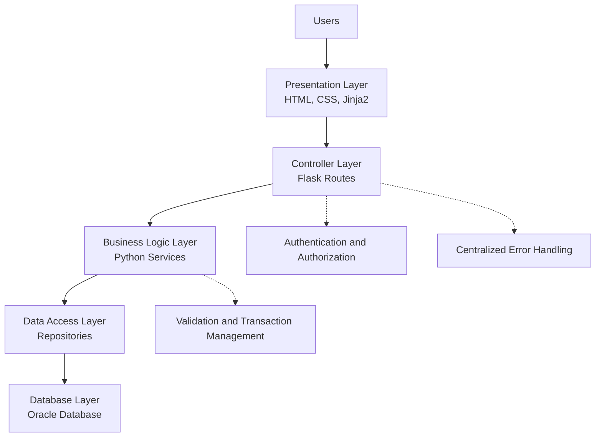

# Forqani Computer Store Management System (FCSMS)


## 1. Project Overview

The **Forqani Computer Store Management System (FCSMS)** is a web-based business management application designed to automate and centralize the daily operational and financial activities of a computer store.

The system integrates product management, inventory control, purchasing, sales, customer and supplier management, financial accounts, multi-currency transactions, warranties, repairs, returns, and operational reporting into a unified platform.

FCSMS is developed as an academic software engineering project using a modular layered architecture, with Python and Flask for backend development and Oracle Database for relational data management.

## 2. Project Objectives

- Automate daily computer store operations.
- Reduce manual record-keeping and data duplication.
- Maintain accurate inventory and financial records.
- Manage customer receivables and supplier payables.
- Support multiple currencies and historical exchange rates.
- Simplify sales, purchasing, invoicing, and payment processing.
- Manage product warranties and after-sales services.
- Maintain traceable repair and financial transaction histories.
- Ensure database integrity, security, and consistency.
- Provide reliable operational and financial reports.

## 3. System Features

The following features represent the defined functional scope of FCSMS v1.0.

### 3.1 User and Employee Management

- User authentication and session management.
- Role-based access control.
- User account activation and deactivation.
- Secure password storage.
- Employee information management.
- Technician assignment.
- User activity tracking.

### 3.2 Product and Category Management

- Product registration and management.
- Unique Stock Keeping Unit (SKU) identification.
- Hierarchical categories and subcategories.
- Product brand and model management.
- Purchase and sale reference prices.
- Product warranty period configuration.
- Product activation and deactivation.

### 3.3 Inventory Management

- Real-time stock balance updates upon successful transaction posting.
- Inventory movement history.
- Automatic stock increases and decreases.
- Low-stock monitoring.
- Configurable reorder levels.
- Authorized inventory adjustments.
- Prevention of negative inventory.
- Separate management of sellable and defective stock.

### 3.4 Customer Management

- Customer registration and information management.
- Customer purchase history.
- Customer financial accounts.
- Outstanding receivable balances.
- Payment and refund history.
- Customer account statements.
- Due-date and overdue balance tracking.

### 3.5 Supplier Management

- Supplier registration and information management.
- Supplier purchase history.
- Supplier financial accounts.
- Outstanding payable balances.
- Supplier payment history.
- Supplier return history.
- Supplier account statements.

### 3.6 Purchase Management

- Purchase registration.
- Multiple products per purchase.
- Fully paid, partially paid, and unpaid purchases.
- Supplier payment tracking.
- Automatic inventory updates.
- Defective product detection upon receipt.
- Supplier warranty dates.
- Purchase history and reporting.

### 3.7 Sales and Invoice Management

- Sales registration and processing.
- Multiple products per invoice.
- Discount calculations.
- Automatic invoice number generation.
- Fully paid, partially paid, and unpaid sales.
- Customer debt tracking.
- Product-specific warranty information on invoices.
- Printable invoices.
- Sales history and reporting.

### 3.8 Customer Return Management

- Product returns linked to original sales invoices.
- Full and partial product returns.
- Refund processing.
- Outstanding customer debt adjustments.
- Returned product condition assessment.
- Automatic restocking of eligible products.
- Transfer of defective returned products to defective stock.
- Return history and reporting.

### 3.9 Supplier Return Management

- Supplier returns linked to original purchases.
- Full and partial supplier returns.
- Supplier refunds and credit adjustments.
- Product replacements.
- Supplier repair processing.
- Returned and received product quantity tracking.
- Supplier return resolution monitoring.
- Financial and inventory adjustments.

### 3.10 Warranty Management

- Product-specific warranty duration.
- Warranty commencement and expiration dates.
- Warranty information on sales invoices.
- Warranty eligibility verification.
- Automatic warranty status calculation.
- Preservation of historical warranty dates.
- Supplier warranty information.

### 3.11 Repair Management

- Customer-owned and store-owned repair cases.
- Unique repair reference numbers.
- Device identification and serial numbers.
- Problem descriptions and technical diagnosis.
- Technician assignment.
- Warranty-covered and chargeable repairs.
- Repair cost and customer charge management.
- Repair payment and outstanding balance tracking.
- Repair status monitoring.
- Device reception and delivery records.

### 3.12 Repair History

- Chronological repair activity records.
- Inspection and diagnosis history.
- Technician assignment history.
- Component replacement records.
- Repair status transitions.
- Testing and completion history.
- Repair delivery history.
- Device-specific repair case tracking.

### 3.13 Defective Stock Management

- Separate defective stock records.
- Product condition and defect descriptions.
- Defective quantity tracking.
- Links to original purchases and customer returns.
- Store repair processing.
- Supplier return processing.
- Restoration of successfully repaired products.
- Authorized inventory write-offs.
- Defective stock reporting.

### 3.14 Financial Account Management

The system manages the following financial account types:

| Account type | Description |
|---|---|
| CASH | Physical store cash |
| BANK | Store bank accounts |
| MOBILE_MONEY | Mobile financial accounts |
| CUSTOMER_RECEIVABLE | Amounts owed by customers |
| SUPPLIER_PAYABLE | Amounts owed to suppliers |
| PERSON_RECEIVABLE | Amounts owed by individual borrowers |
| PERSON_PAYABLE | Amounts owed to individual lenders |

Each financial account operates in a designated currency and maintains a traceable transaction history.

### 3.15 Payment Management

- Sales payment processing.
- Purchase payment processing.
- Partial and complete settlements.
- Customer refunds.
- Supplier refunds.
- Repair payment collection.
- Repair cost payments.
- Payment direction and method tracking.
- Financial account allocation.
- Payment history.

### 3.16 Loan Management

- Interest-free loans given by the store.
- Interest-free loans received by the store.
- Loan principal and due-date management.
- Partial and complete repayments.
- Automatic remaining balance calculation.
- Loan payment history.
- Loan account statements.

### 3.17 Financial Ledger Management

- Centralized financial account movement records.
- IN and OUT transaction directions.
- Transaction source identification.
- Related transaction grouping.
- Account balance calculations.
- Financial adjustment tracking.
- Transaction reversal records.
- Historical financial account statements.

The financial ledger is an operational account-movement ledger rather than a complete double-entry accounting system.

### 3.18 Multi-Currency Management

FCSMS supports the following currencies:

| Currency | Code |
|---|---|
| Afghan Afghani | AFN |
| United States Dollar | USD |
| Pakistani Rupee | PKR |

Currency management includes:

- Currency-specific financial accounts.
- Current exchange-rate management.
- Historical exchange-rate records.
- Transaction-level exchange-rate snapshots.
- Historical transaction valuation.
- AFN-based consolidated reporting.
- Native-currency account balances.

AFN serves as the system's base reporting currency.

### 3.19 Account Transfer Management

- Transfers between store financial accounts.
- Same-currency transfers.
- Cross-currency exchange transfers.
- Source and destination account identification.
- Executed exchange-rate recording.
- Linked incoming and outgoing ledger movements.
- Authorized transfer reversals.
- Transfer history.

### 3.20 Reporting and Auditing

- Sales reports.
- Purchase reports.
- Inventory reports.
- Low-stock reports.
- Customer account statements.
- Supplier account statements.
- Receivable and payable reports.
- Payment reports.
- Loan reports.
- Financial account statements.
- Ledger transaction reports.
- Currency and exchange-rate reports.
- Account transfer reports.
- Warranty reports.
- Repair reports.
- Repair history reports.
- Supplier return reports.
- Customer return reports.
- Defective stock reports.
- Report generation history.
- User activity and audit records.

## 4. Technology Stack

| Component | Technology |
|---|---|
| Backend Language | Python |
| Web Framework | Flask |
| Frontend | HTML5, CSS3 |
| Template Engine | Jinja2 |
| Client-Side Enhancement | JavaScript (optional) |
| Database | Oracle Database |
| Database Language | Oracle SQL and PL/SQL |
| Database Connectivity | python-oracledb |
| Architecture | Modular Layered Architecture |
| Database Modeling | Entity Relationship Diagram (ERD) |
| Modeling Tools | Draw.io, Eraser |
| Version Control | Git |
| Repository Management | GitHub |

## 5. System Architecture

FCSMS follows a modular layered architecture that separates presentation, request handling, business logic, and database operations.



### Presentation Layer

Responsible for user interfaces, forms, navigation, dashboards, invoices, and report presentation.

### Controller Layer

Responsible for HTTP requests, Flask routes, session management, authentication, and responses.

### Business Logic Layer

Responsible for business rules, input validation, calculations, inventory operations, financial transactions, and authorization.

### Data Access Layer

Responsible for parameterized SQL queries, repository operations, and Oracle database connectivity.

### Database Layer

Responsible for data persistence, relational integrity, constraints, transaction consistency, and historical records.

## 6. Database Design

The relational database model consists of:

| Component | Quantity |
|---|---:|
| Core Entities | 30 |
| Logical Attributes | 340 |
| Foreign-Key Relationship Roles | 91 |
| Functional Requirement Groups | 28 |
| Acceptance Test Scenarios | 37 |

### Database Entities

| No. | Entity | Responsibility |
|---:|---|---|
| 01 | `USERS` | Application users and authorization |
| 02 | `EMPLOYEES` | Employee and technician records |
| 03 | `CUSTOMERS` | Customer information |
| 04 | `SUPPLIERS` | Supplier information |
| 05 | `FINANCIAL_ACCOUNT` | Financial accounts |
| 06 | `PRODUCTS` | Product catalog |
| 07 | `INVENTORY` | Sellable stock balances |
| 08 | `INVENTORY_MOVEMENTS` | Stock movement history |
| 09 | `CATEGORIES` | Categories and subcategories |
| 10 | `PURCHASES` | Purchase transactions |
| 11 | `PURCHASE_ITEMS` | Individual purchase items |
| 12 | `SALES` | Sales transactions |
| 13 | `SALE_ITEMS` | Individual sold items and warranties |
| 14 | `PAYMENTS` | Financial settlements |
| 15 | `RETURNS` | Customer returns |
| 16 | `RETURNS_ITEMS` | Individual returned items |
| 17 | `LOANS` | Loans given and received |
| 18 | `LOAN_PAYMENTS` | Loan repayments |
| 19 | `LEDGER_TRANSACTIONS` | Financial account movements |
| 20 | `ACCOUNT_BALANCES` | Calculated account balances |
| 21 | `AUDIT_LOG` | System activity records |
| 22 | `REPORT_HISTORY` | Generated report metadata |
| 23 | `CURRENCIES` | Currency master records |
| 24 | `ACCOUNT_TRANSFERS` | Internal financial transfers |
| 25 | `EXCHANGE_RATE_HISTORY` | Historical exchange rates |
| 26 | `REPAIRS` | Product repair cases |
| 27 | `SUPPLIER_RETURNS` | Supplier return transactions |
| 28 | `SUPPLIER_RETURN_ITEMS` | Individual supplier return items |
| 29 | `DEFECTIVE_STOCK` | Defective stock records |
| 30 | `REPAIR_HISTORY` | Repair activity history |

### Database Design Principles

- Relational database normalization.
- Primary and foreign key constraints.
- Unique and composite unique constraints.
- Referential integrity.
- Mandatory and optional participation.
- Atomic transaction processing.
- Historical exchange-rate preservation.
- Controlled derived attributes and stored balances.
- Prevention of duplicate financial postings.
- Preservation of historical transaction records.

## 7. Proposed Project Structure

```text
FCSMS/
├── app.py
├── requirements.txt
├── README.md
├── .gitignore
├── .env.example
│
├── backend/
│   ├── routes/
│   ├── services/
│   ├── repositories/
│   ├── validators/
│   ├── handlers/
│   ├── exceptions/
│   ├── utils/
│   └── config/
│
├── database/
│   ├── connection.py
│   ├── schema/
│   ├── migrations/
│   └── scripts/
│
├── templates/
│   ├── auth/
│   ├── dashboard/
│   ├── products/
│   ├── inventory/
│   ├── customers/
│   ├── suppliers/
│   ├── purchases/
│   ├── sales/
│   ├── returns/
│   ├── repairs/
│   ├── finance/
│   └── reports/
│
├── static/
│   ├── css/
│   ├── js/
│   └── images/
│
├── tests/
│   ├── unit/
│   └── integration/
│
└── docs/
    ├── requirements/
    ├── architecture/
    ├── database/
    ├── diagrams/
    ├── development/
    └── testing/
```

The structure separates application responsibilities and allows team members to develop individual modules independently before integration.

## 8. System Users

| Role | Primary Responsibilities |
|---|---|
| Administrator | User management, authorization, configuration, auditing, and system administration |
| Manager | Store operations, financial management, reporting, and authorized approvals |
| Sales Staff | Customer management, sales, invoices, and permitted payment operations |
| Inventory Staff | Products, categories, purchasing, inventory, and defective stock |

Access to individual operations is controlled through role-based permissions.

## 9. Development Methodology

FCSMS follows a **Hybrid Software Development Methodology**, combining Plan-Driven Development with Agile practices.

### Plan-Driven Development

Used for:

- Requirements analysis.
- Software requirements specification.
- Database design.
- System architecture.
- System modeling.
- Development planning.
- Technical documentation.

### Agile Development

Used for:

- Iterative module implementation.
- Task assignment.
- Incremental integration.
- Continuous testing.
- Team collaboration.
- Feedback and defect resolution.

This approach maintains structured documentation while supporting incremental implementation.

## 10. Security and Data Integrity

The system is designed to implement:

- Secure password hashing.
- Role-based access control.
- Session management.
- CSRF protection.
- Server-side input validation.
- Parameterized Oracle SQL queries.
- Environment-based configuration.
- Database constraints.
- Atomic commit and rollback operations.
- Centralized exception handling.
- Audit logging.
- Authorized transaction reversals.
- Database backup and recovery.

Sensitive information, database credentials, and application secret keys must not be committed to the repository.

## 11. Installation and Configuration

### Prerequisites

- Python 3
- Oracle Database
- Git
- A modern web browser
- Access to the FCSMS repository

### Create a Virtual Environment

```bash
python -m venv venv
```

Activate the virtual environment on Windows:

```bash
venv\Scripts\activate
```

On Linux or macOS:

```bash
source venv/bin/activate
```

### Install Dependencies

Once the project dependency file is available:

```bash
pip install -r requirements.txt
```

### Configure the Database

1. Create an authorized Oracle database user and schema.
2. Configure the Oracle connection settings.
3. Execute the project's database schema and initialization scripts in the required order.
4. Configure the application environment variables.

Example environment configuration:

```env
DB_USER=your_database_user
DB_PASSWORD=your_database_password
DB_HOST=localhost
DB_PORT=1521
DB_SERVICE_NAME=your_service_name
SECRET_KEY=your_secret_key
```

### Run the Application

Once the Flask application entry point is implemented:

```bash
python app.py
```

Default local development address:

```text
http://127.0.0.1:5000
```

The installation commands and configuration names should be aligned with the implemented repository structure.

## 12. Project Documentation

| Document | Description |
|---|---|
| Software Requirements Specification v1.0 | Complete system requirements |
| System Architecture v1.0 | Application architecture and component interactions |
| Database Design Documentation v1.0 | Entities, attributes, relationships, and integrity constraints |
| Entity Relationship Diagram | Relational database model |
| System Modeling Documentation | UML diagrams and system behavior |
| Requirements Prioritization | Separate implementation priorities |
| Development Plan | Tasks, responsibilities, and implementation organization |
| Testing Documentation | Test cases, acceptance criteria, and verification results |

All project documentation is maintained separately from application source code.

## 13. Testing and Quality Assurance

The testing process covers:

- Unit testing.
- Integration testing.
- Database integrity testing.
- Functional testing.
- Authentication and authorization testing.
- Financial transaction testing.
- Inventory consistency testing.
- Multi-currency transaction testing.
- Warranty and repair workflow testing.
- Customer and supplier return testing.
- User acceptance testing.

The specification defines 37 acceptance test scenarios for verifying the agreed system scope.

## 14. Version Control and Collaboration

Git and GitHub are used for:

- Source code management.
- Task and issue tracking.
- Branch-based development.
- Pull requests.
- Code reviews.
- Documentation management.
- Integration and defect resolution.

### Branch Naming Conventions

```text
main
develop
feature/module-name
fix/issue-name
docs/document-name
test/module-name
```

### Commit Message Conventions

```text
feat: implement product management
fix: correct inventory quantity calculation
docs: add database design documentation
refactor: improve financial transaction service
test: add supplier return test cases
chore: update project dependencies
```

Team members should associate changes with relevant GitHub issues and submit reviewed pull requests before integrating modules.

## 15. Project Status

| Item | Information |
|---|---|
| Project Name | Forqani Computer Store Management System |
| Abbreviation | FCSMS |
| Version | 1.0 |
| Project Type | Academic Software Engineering Project |
| Application Type | Web Application |
| Deployment Scope | Single Store |
| Database | Oracle Database |
| Development Approach | Hybrid Development |
| Status | In Development |

The system scope has been defined. Implementation, integration, and testing progress is tracked through GitHub Issues and project documentation.

## 16. Development Team

Developed collaboratively by the FCSMS Project Team.

Team responsibilities include:

- Project management.
- Requirements engineering.
- Database design and implementation.
- Backend development.
- Frontend development.
- System integration.
- Testing and documentation.

## 17. Acknowledgments

This project is developed for academic purposes to demonstrate practical knowledge of software engineering, relational database design, web application development, financial transaction processing, and collaborative software development.

---

**Forqani Computer Store Management System (FCSMS) — Version 1.0**

*Academic Software Engineering Project*