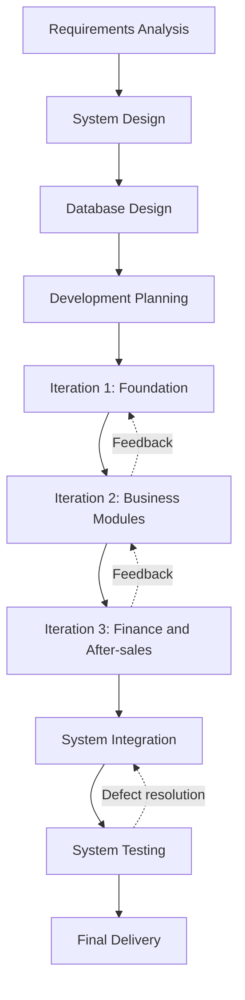
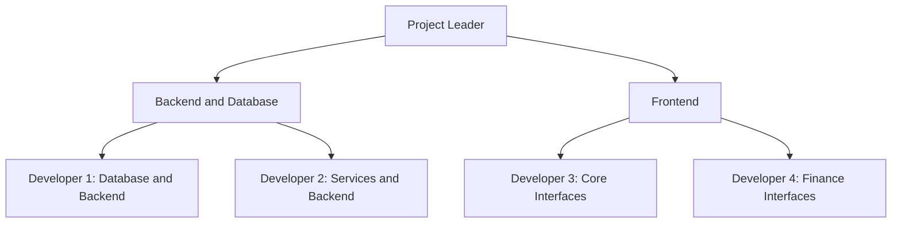
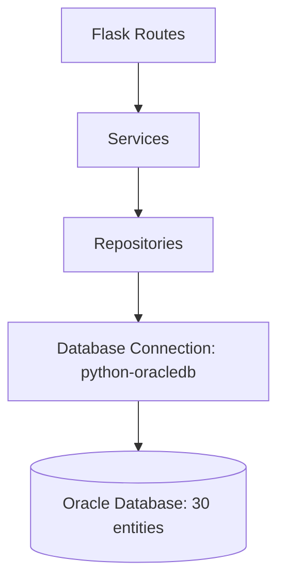
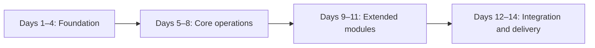
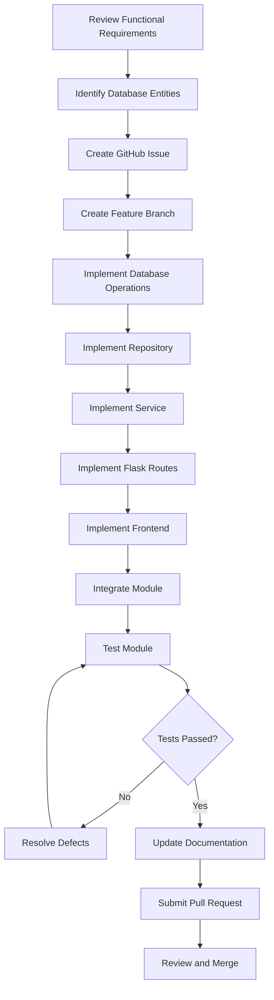
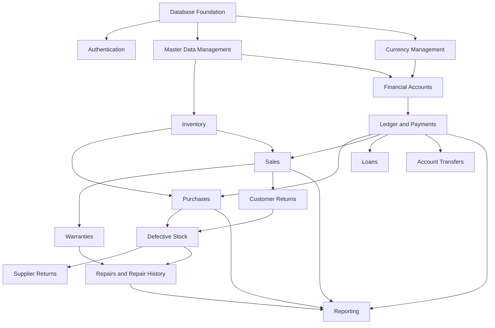
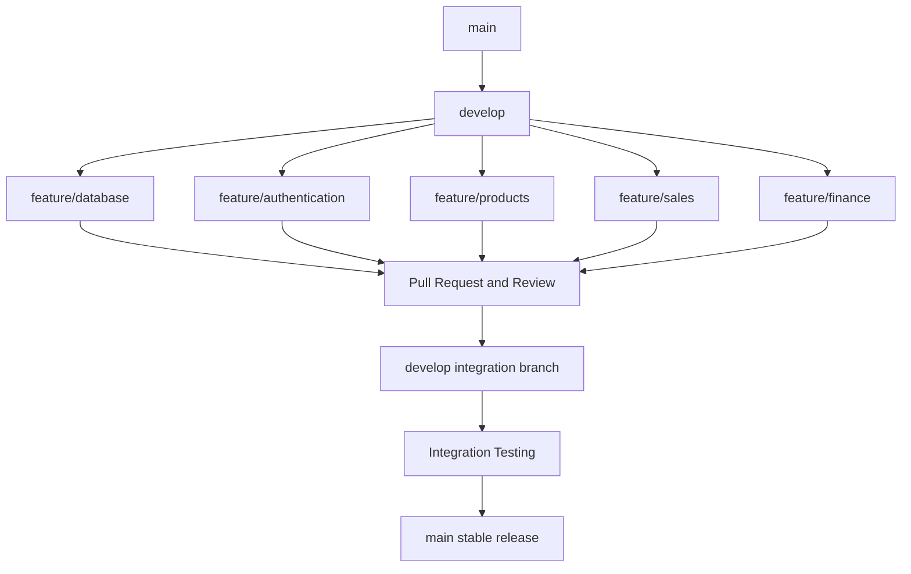

# FCSMS — Software Development Plan

## 1. Project information

| Item | Description |
|---|---|
| Project | Forqani Computer Store Management System (FCSMS) |
| Document ID | FCSMS-PLAN-05 |
| Version | 1.0 |
| Project type | Academic Software Engineering Project |
| Team size | 4 members |
| Proposed duration | 14 working days |
| Methodology | Plan-Driven + Scrum |
| Backend | Python and Flask |
| Frontend | HTML, CSS, Jinja2 |
| Database | Oracle Database |
| Version control | Git and GitHub |
| Database entities | 30 |
| Functional requirement groups | 28 |

## 2. Development objectives

- Implement the system according to the defined requirements and database design.
- Develop individual functional modules independently.
- Maintain consistent interfaces between frontend, backend, and database components.
- Ensure inventory and financial transaction integrity.
- Integrate and test modules incrementally.
- Maintain technical documentation throughout development.
- Deliver a functional and demonstrable academic application.

## 3. Development methodology

FCSMS follows a hybrid development methodology combining plan-driven requirements and technical specifications with Scrum implementation sprints.



| Plan-driven practices | Agile practices |
|---|---|
| Requirements specification | Short development iterations |
| Database design | Product backlog |
| System architecture | Daily team meetings |
| System modeling | Incremental module delivery |
| Development scheduling | Continuous testing |
| Technical documentation | Feedback and adaptation |

## 4. Development team and responsibilities

The four-member team is divided into two backend/database developers and two frontend developers. The project leader is one of the four members.



| Member | Assigned responsibilities |
|---|---|
| Developer 1 | Oracle database, schema, constraints, repositories, authentication and inventory backend |
| Developer 2 | Sales, purchases, payments, financial accounts, loans, repairs and transaction services |
| Developer 3 | Login, dashboard, products, categories, customers, suppliers, inventory and purchasing interfaces |
| Developer 4 | Sales, invoices, returns, repairs, financial accounts, payments and reporting interfaces |

### 4.1 Project leader responsibilities

Task distribution, requirements management, progress monitoring, technical consistency, pull request reviews, integration coordination, risk management, and final delivery.

## 5. Development priorities

Prioritization is maintained separately from the Software Requirements Specification.

| Priority | Meaning |
|---|---|
| P0 | Essential system foundation |
| P1 | Core business functionality |
| P2 | Extended business functionality |
| P3 | Secondary functionality and quality improvements |

| Module | Priority |
|---|---|
| Database and configuration | P0 |
| Authentication and authorization | P0 |
| Products and categories | P1 |
| Customers and suppliers | P1 |
| Inventory and inventory movements | P1 |
| Purchases and purchase items | P1 |
| Sales, sale items and invoices | P1 |
| Financial accounts and balances | P1 |
| Payments and ledger transactions | P1 |
| Currency management | P1 |
| Customer returns | P1 |
| Warranty management | P2 |
| Loans and loan payments | P2 |
| Account transfers | P2 |
| Exchange-rate history | P2 |
| Defective stock | P2 |
| Supplier returns | P2 |
| Repairs and repair history | P2 |
| Operational reporting | P2 |
| Advanced report exports and UI improvements | P3 |

Priorities determine implementation order, not removal from the agreed system scope. Transaction integrity and security requirements apply from the beginning. Supporting functionality needed by earlier modules (including exchange-rate history, defective-stock handling and invoice warranty dates) must be implemented before dependent transactions are enabled.

## 6. Development phases

### Phase 1 — Requirements and system design

| Task | Deliverable |
|---|---|
| Requirements analysis | Software Requirements Specification |
| Architecture design | System Architecture Documentation |
| Database design | Database Design Documentation |
| Entity relationship modeling | ERD |
| Structural and behavioral modeling | UML and system diagrams |
| Development scheduling | Software Development Plan |

Design documents have been drafted. Team review and approval should be recorded before treating this phase as complete.

### Phase 2 — Development environment setup

- [ ] Configure GitHub repository.
- [ ] Install Python.
- [ ] Install and configure Oracle Database.
- [ ] Create Python virtual environment.
- [ ] Install `requirements.txt` dependencies.
- [ ] Configure environment variables.
- [ ] Establish project folder structure.
- [ ] Configure Oracle database connectivity.
- [ ] Configure Flask application.
- [ ] Verify application-to-database connection.

### Phase 3 — Database implementation

| Group | Database entities |
|---|---|
| 1. Independent master tables | USERS, CUSTOMERS, SUPPLIERS, CATEGORIES, CURRENCIES |
| 2. Dependent master tables | EMPLOYEES, PRODUCTS, FINANCIAL_ACCOUNT |
| 3. Balance tables | INVENTORY, ACCOUNT_BALANCES |
| 4. Purchase and sale tables | PURCHASES, PURCHASE_ITEMS, SALES, SALE_ITEMS |
| 5. Customer returns | RETURNS, RETURNS_ITEMS |
| 6. After-sales tables | SUPPLIER_RETURNS, SUPPLIER_RETURN_ITEMS, DEFECTIVE_STOCK, REPAIRS, REPAIR_HISTORY |
| 7. Financial tables | LOANS, LOAN_PAYMENTS, ACCOUNT_TRANSFERS, PAYMENTS, LEDGER_TRANSACTIONS |
| 8. Historical tables | EXCHANGE_RATE_HISTORY, INVENTORY_MOVEMENTS, AUDIT_LOG, REPORT_HISTORY |

Because SUPPLIER_RETURN_ITEMS and DEFECTIVE_STOCK reference each other, their circular foreign-key dependencies should be established using `ALTER TABLE` after both tables exist.

**Deliverables:** Oracle DDL scripts, primary keys, foreign keys, unique constraints, check constraints, indexes, initialization data, and database verification tests.

### Phase 4 — Backend development



Each backend module should include route handling, authorization, input validation, service logic, repository functions, transaction management, error handling, and appropriate tests.

### Phase 5 — Frontend development

Frontend developers can prepare layouts and templates while database and backend implementation progresses. Actual functional integration follows the completed backend interfaces.

| Stage | Tasks |
|---|---|
| 1 | Establish typography, colors, layout and reusable components |
| 2 | Develop login and authentication pages |
| 3 | Develop dashboard and navigation |
| 4 | Develop product, customer and supplier interfaces |
| 5 | Develop inventory, purchase and sales interfaces |
| 6 | Develop finance and after-sales interfaces |
| 7 | Develop reports, tables, filters and validation messages |
| 8 | Connect templates and forms to Flask routes |

### Phase 6 — Incremental integration

Each module is integrated after its database, backend, frontend, and tests are ready. Integration should not be postponed entirely until the final development day.

### Phase 7 — System testing

Verify individual components and complete business workflows using the acceptance criteria in the SRS.

### Phase 8 — Final delivery

Prepare the database scripts, working application, technical documentation, installation instructions, demonstration data, and academic presentation.

## 7. Development iterations

| Iteration | Days | Scope |
|---|---|---|
| 1 — System foundation | 1–4 | Environment, database, authentication, master data, inventory foundation, basic interfaces |
| 2 — Core business operations | 5–8 | Purchasing, sales, invoices, payments, financial accounts, ledger and customer returns |
| 3 — Extended functionality | 9–11 | Loans, transfers, exchange-rate history, warranties, defective stock, supplier returns, repairs and reporting |
| 4 — Integration and delivery | 12–14 | Integration, defect resolution, reconciliation, documentation and demonstration |

## 8. Development schedule

Days are relative to the start of implementation. The schedule is proposed, not a record of completed work.

| Workstream | Start day | End day |
|---|---:|---:|
| Environment setup | 1 | 1 |
| Database | 1 | 3 |
| Authentication | 2 | 4 |
| Master data | 3 | 4 |
| Frontend foundation | 1 | 4 |
| Purchase and inventory | 4 | 6 |
| Sales and invoices | 5 | 7 |
| Payments and ledger | 5 | 8 |
| Customer returns | 7 | 8 |
| Extended finance | 8 | 11 |
| After-sales modules | 8 | 11 |
| Reporting | 10 | 12 |
| Integration and testing | 4 | 14 |
| Final delivery | 13 | 14 |



### Daily task distribution

| Day | Backend and database team | Frontend team |
|---:|---|---|
| 1 | Environment, database schema | Design system and application layout |
| 2 | Database constraints and connectivity | Login page and navigation |
| 3 | Authentication and master repositories | Dashboard, product and category interfaces |
| 4 | Customers, suppliers and inventory | Customer, supplier and inventory interfaces |
| 5 | Purchasing and financial accounts | Purchase and financial account interfaces |
| 6 | Sales and payment services | Sales and payment interfaces |
| 7 | Ledger, balances and invoice generation | Invoice and ledger interfaces |
| 8 | Customer returns and currency operations | Returns and currency interfaces |
| 9 | Loans and account transfers | Loan and transfer interfaces |
| 10 | Defective stock and supplier returns | Defective stock and supplier return interfaces |
| 11 | Repairs, warranty and repair history | Repair and warranty interfaces |
| 12 | Reporting and integration | Reporting and interface integration |
| 13 | Database and business logic testing | UI and functional testing |
| 14 | Final defect resolution and delivery | Documentation and demonstration |

## 9. Module development procedure



### Example: Product management module

| Step | Implementation |
|---:|---|
| 1 | Review FR-02 and FR-03 |
| 2 | Verify PRODUCTS and CATEGORIES tables |
| 3 | Create GitHub issue |
| 4 | Create `feature/product-management` branch |
| 5 | Implement product repository |
| 6 | Implement product service |
| 7 | Implement product routes |
| 8 | Implement product HTML templates |
| 9 | Connect frontend and backend |
| 10 | Test product operations |
| 11 | Document implementation |
| 12 | Review and merge |

This procedure applies to all functional modules.

## 10. Module dependency planning

These are development dependencies rather than database foreign-key relationships.



## 11. GitHub project management

### 11.1 Milestones

| Milestone | Scope |
|---|---|
| M01 | Requirements and System Design |
| M02 | Database Implementation |
| M03 | Application Foundation |
| M04 | Core Business Operations |
| M05 | Financial Management |
| M06 | After-Sales Management |
| M07 | Reporting and Auditing |
| M08 | Integration and Testing |
| M09 | Final Delivery |

### 11.2 Project board

| Column | Example |
|---|---|
| Backlog | FR-25 Repair management; FR-26 Supplier returns |
| Ready | Configure Oracle; implement authentication |
| In progress | Assigned development tasks |
| In review | Pull requests; module verification |
| Testing | Integration and acceptance tests |
| Done | Reviewed and accepted tasks |

This is an illustrative board structure, not the current repository status.

### 11.3 Issue labels

| Label | Purpose |
|---|---|
| `database` | Database implementation |
| `backend` | Python and Flask development |
| `frontend` | Interface development |
| `documentation` | Technical documentation |
| `testing` | Test implementation |
| `bug` | Defect resolution |
| `feature` | Functional implementation |
| `priority:P0` | Essential foundation |
| `priority:P1` | Core functionality |
| `priority:P2` | Extended functionality |
| `priority:P3` | Secondary improvements |

### 11.4 Git branching strategy



The `main` branch contains stable versions. The `develop` branch is used for integration, and individual feature branches are used for module implementation.

### 11.5 GitHub issue template

```markdown
## Task Description
Describe the functionality to be implemented.

## Related Requirements
- Requirement ID: FR-XX

## Database Entities
Identify the affected database tables.

## Implementation Tasks
- [ ] Verify database structure
- [ ] Implement repository functions
- [ ] Implement business logic
- [ ] Implement Flask routes
- [ ] Implement frontend templates
- [ ] Integrate the module
- [ ] Implement and execute tests
- [ ] Update documentation

## Acceptance Criteria
- Functionality satisfies the corresponding requirements.
- Input validation and authorization are implemented.
- Database integrity is maintained.
- Tests pass successfully.
- Code is reviewed before merging.

## Assignment
- Assignee:
- Priority:
- Milestone:
- Dependencies:
```

## 12. Documentation management

| Document | Purpose |
|---|---|
| 01 — Software Requirements Specification | Defines system requirements |
| 02 — System Architecture | Defines technical structure |
| 03 — Database Design | Defines database entities and constraints |
| 04 — System Modeling | Defines structural and behavioral models |
| 05 — Development Plan | Defines tasks, priorities and scheduling |
| 06 — Implementation Documentation | Records module implementation |
| 07 — Testing Documentation | Records tests and results |
| 08 — User Manual | Explains system operations |
| 09 — Installation Guide | Explains deployment and configuration |

```text
 docs/
 ├── Software_System_Specification.md
 ├── System_Architecture.md
 ├── Database_Design.md
 ├── System_Modeling.md
 ├── Development_Plan.md
 ├── Implementation_Documentation.md
 ├── Testing_Documentation.md
 ├── User_Manual.md
 ├── Installation_Guide.md
 ├── diagrams/
 ├── implementation/
 ├── testing/
 └── meeting_records/
```

Maintain one implementation document per significant module rather than a separate document for every Python function. Record function-level technical details in code documentation where necessary.

## 13. Testing strategy

| Testing type | Purpose | Responsible |
|---|---|---|
| Database testing | Constraints and referential integrity | Backend team |
| Unit testing | Individual functions and services | All developers |
| Integration testing | Communication between modules | All developers |
| Functional testing | Compliance with functional requirements | All developers |
| Interface testing | Forms, layouts and usability | Frontend team |
| Security testing | Authentication and authorization | Backend team |
| Acceptance testing | Verification against SRS | Project leader and team |
| Regression testing | Ensure changes do not break existing functionality | All developers |

Critical business scenarios include insufficient inventory, partial payments, customer debt, supplier debt, duplicate transactions, loan repayments, currency conversion, account transfers, product returns, warranty verification, defective stock restoration, and transaction rollback.

Track all 37 acceptance test scenarios defined in the SRS with actual execution results.

## 14. Definition of Done

- [ ] Implementation matches the functional requirements.
- [ ] Database operations are correct.
- [ ] Business rules and validations are implemented.
- [ ] Authorization is enforced.
- [ ] Frontend and backend are integrated where applicable.
- [ ] Error handling is implemented.
- [ ] Relevant tests pass.
- [ ] Technical documentation is updated.
- [ ] Code is reviewed.
- [ ] Pull request is approved and merged.

## 15. Risk management

| Risk | Probability | Impact | Mitigation |
|---|---|---|---|
| Insufficient development time | High | High | Prioritize essential modules |
| Limited team experience | High | High | Small tasks, technical guidance and reviews |
| Oracle configuration problems | Medium | High | Verify environment on the first day |
| Database inconsistencies | Medium | High | Constraints and database testing |
| Financial calculation errors | Medium | High | Decimal arithmetic and transaction tests |
| Module integration problems | High | High | Continuous incremental integration |
| Git merge conflicts | Medium | Medium | Feature branches and clear task ownership |
| Incomplete documentation | Medium | Medium | Include documentation in Definition of Done |
| Unreliable AI-generated code | Medium | High | Manual review and testing |
| Requirements changes | Medium | High | Maintain scope and controlled change requests |

## 16. Daily team meetings

Conduct a daily meeting of approximately 10–15 minutes. Each team member answers:

1. What did I complete yesterday?
2. What will I implement today?
3. What problems are preventing my progress?

The project leader records completed tasks, unresolved issues, dependencies, and assigned corrective actions.

## 17. Final project deliverables

| Deliverable | Acceptance condition |
|---|---|
| Application source code | Organized and accessible through GitHub |
| Oracle database scripts | Schema can be initialized successfully |
| Web application | Runs in the documented environment |
| Business modules | Implemented scope is demonstrable |
| System documentation | Consistent with implementation |
| System diagrams | Editable and accurate |
| Testing report | Contains actual test results |
| Installation guide | Reproducible setup instructions |
| User manual | Explains implemented operations |
| Academic presentation | Demonstrates system design and functionality |

## 18. Final development recommendations

- Complete the database foundation first.
- Establish backend interfaces before connecting frontend functionality.
- Allow frontend developers to prepare interfaces in parallel.
- Develop the system module by module.
- Integrate continuously instead of waiting until every module is finished.
- Never commit passwords or database credentials.
- Maintain financial and inventory integrity throughout development.
- Do not expand the agreed 30-entity scope during implementation.


## 19. Costing and financial reporting delivery

The implementation sequence uses the team's Plan-Driven and Scrum approach. Apply the tasks inside the existing four sprints and 14 working days. The controlled release remains v1.0 with 30 entities and 28 FR groups.

1. Database and inventory foundation. Add the fields and constraints in Database Design. Implement decimal rules and verify migrated opening stock before allowing new costing-enabled postings.
2. Purchasing, sales and invoices. Post moving averages, lock sale inventory, freeze COGS and warranty, and show the snapshot on invoice reprint.
3. Returns, after-sales and finance. Verify source cost, custody, original AFN revenue basis and write-off evidence. Add paid expense posting and linked reversal. Reconcile balances after concurrent and duplicate requests.
4. Reporting and verification. Implement date presets, custom filters, P&L, operations, expenses, losses and comparison. Reconcile screen/exports and run AT-01 through AT-53 before release.
