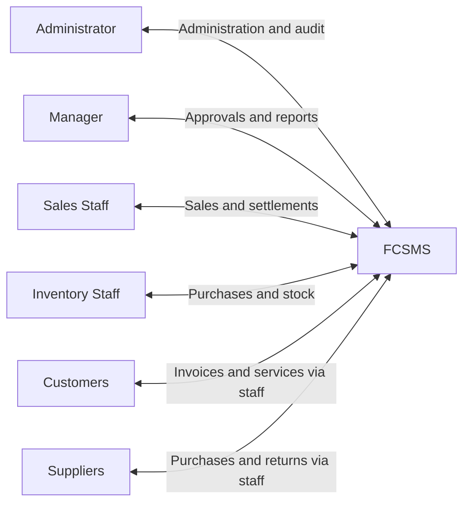
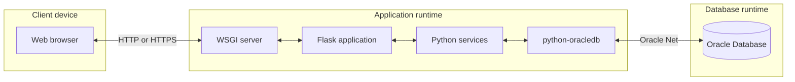
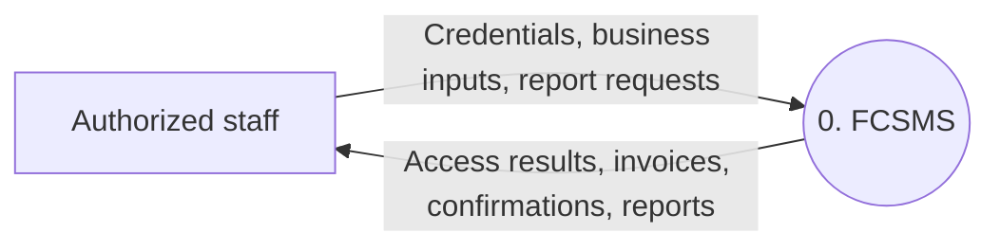
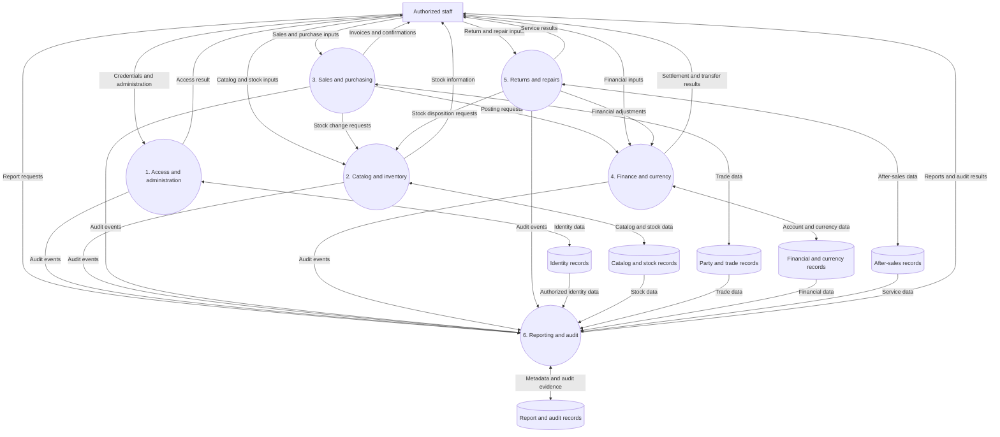
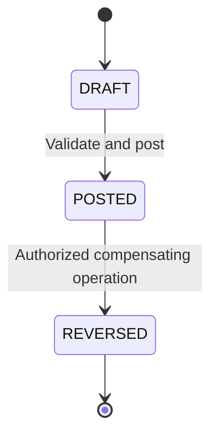
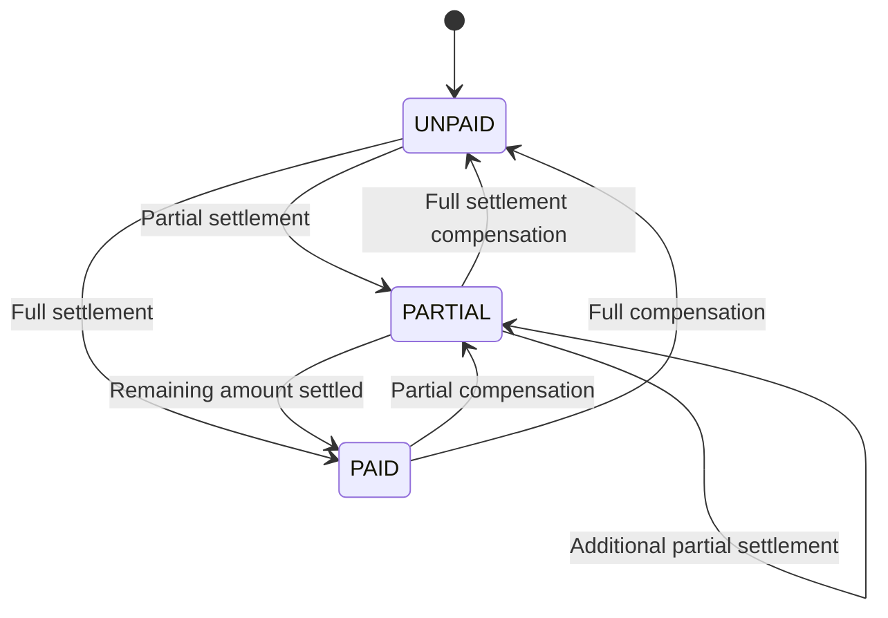
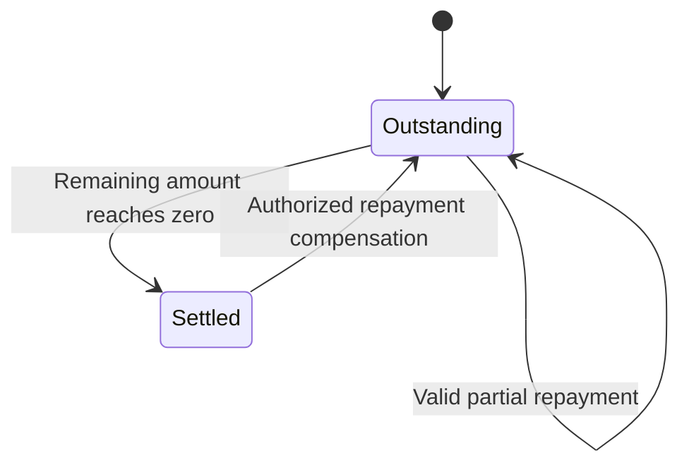
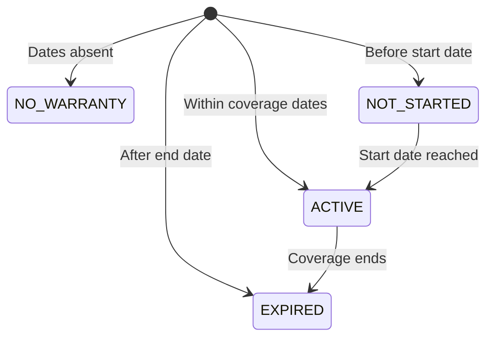
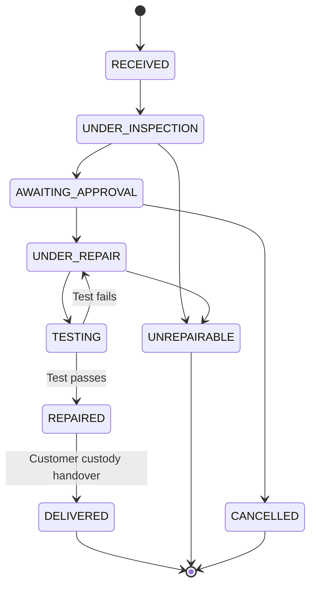

# FCSMS — System Modeling Documentation

## Document control

| Item | Value |
|---|---|
| Project | Forqani Computer Store Management System (FCSMS) |
| Document ID | FCSMS-MODEL-04 |
| Version | 1.0 |
| Authors | FCSMS Project Team |
| Scope | Academic, single-store web application |
| Requirements baseline | SRS v1.0 |
| Database baseline | 30 entities, 340 logical attributes, 91 foreign-key roles |
| Modeling tools | Mermaid, Draw.io |
| Status | Design documentation; implementation verification tracked separately |

## 1. Purpose and scope

This document describes the structure, behavior, interactions and data flows of FCSMS. It establishes a common model for the presentation, controller, business logic and Oracle data-access layers. The models cover administration, catalog, inventory, purchasing, sales, warranties, customer and supplier returns, repairs, defective stock, financial accounts, payments, loans, internal transfers, currencies, reporting and auditing.

The separate diagram files are part of this document. They contain editable Mermaid source, not screenshots. Service and component names are logical responsibilities, not assertions about implemented Python classes. The model does not introduce additional database tables or user roles.

## 2. Diagram index

| Model | Location | Contents |
|---|---|---|
| System context | Section 3 | System boundary and external participants |
| Use case | [use_case.md](diagrams/use_case.md) | Four actor-oriented functional views |
| Class | [class.md](diagrams/class.md) | Logical application service classes and dependencies |
| Entity relationship | Section 5; master ERD maintained separately | Thirty-entity relational model |
| Component | [component.md](diagrams/component.md) | Layered application components |
| Deployment | Section 7 | Browser, application and database runtime nodes |
| Data flow | Section 8 | Level 0 and Level 1 logical information flows |
| Activity | [activity.md](diagrams/activity.md) | Seven business workflows |
| Sequence | [sequence.md](diagrams/sequence.md) | Ten application interaction sequences |
| State machine | Section 11 | Document, settlement, loan, warranty and repair lifecycles |

## 3. System context model

FCSMS is accessed by authorized store staff. Customers and suppliers participate in business processes through staff; they are not assumed to have direct application accounts. No external payment gateway or live exchange-rate service is assumed.

## 4. Use case model

See [Use Case Diagrams](diagrams/use_case.md).

| Actor | Main responsibilities |
|---|---|
| Administrator | User administration, authorization, configuration, audit review |
| Manager | Business operations, financial management, reports and authorized approvals |
| Sales Staff | Customer operations, sales, invoices and permitted settlements |
| Inventory Staff | Catalog, stock, purchasing and permitted inventory operations |

Technicians are represented by employee records; a technician assignment does not itself grant application permissions. The SRS remains authoritative for authorization. Mermaid use case views are UML-inspired flowcharts rather than formal UML use case notation.

## 5. Structural models

### 5.1 Class model

See [Class Diagram](diagrams/class.md) for service responsibilities and dependencies. Domain services apply business rules and coordinate operations. Repositories execute parameterized Oracle SQL and do not commit independently within a multi-table posting operation.

### 5.2 Entity relationship model

The master ERD is maintained separately. The following inventory identifies every entity and its bounded context; it is not a replacement for the complete attribute and relationship register in the database design documentation.

| Domain | Entities | Count |
|---|---|---:|
| Administration | USERS, EMPLOYEES, AUDIT_LOG, REPORT_HISTORY | 4 |
| Business parties | CUSTOMERS, SUPPLIERS | 2 |
| Catalog and inventory | PRODUCTS, CATEGORIES, INVENTORY, INVENTORY_MOVEMENTS, DEFECTIVE_STOCK | 5 |
| Purchasing | PURCHASES, PURCHASE_ITEMS, SUPPLIER_RETURNS, SUPPLIER_RETURN_ITEMS | 4 |
| Sales and returns | SALES, SALE_ITEMS, RETURNS, RETURNS_ITEMS | 4 |
| Repairs | REPAIRS, REPAIR_HISTORY | 2 |
| Finance | FINANCIAL_ACCOUNT, ACCOUNT_BALANCES, PAYMENTS, LOANS, LOAN_PAYMENTS, LEDGER_TRANSACTIONS, ACCOUNT_TRANSFERS | 7 |
| Currency | CURRENCIES, EXCHANGE_RATE_HISTORY | 2 |
| **Total** | | **30** |

Use Crow's Foot notation with explicit minimum/maximum participation where the diagram editor supports it. A nullable FK permits zero or one parent; a required FK identifies exactly one parent. A unique FK restricts the parent to at most one child. Posted document headers require at least one item; a registered repair requires at least one history event. Multiple foreign keys between the same entities represent distinct roles. Recursive relationships include category hierarchy, transfer reversals, exchange-rate supersession and defective-stock splits.

## 6. Component model

See [Component Diagram](diagrams/component.md).

| Layer | Responsibility |
|---|---|
| Presentation | HTML, CSS and Jinja2 templates; optional JavaScript enhancement |
| Controller | Flask routes, request validation, sessions, authorization and responses |
| Business logic | Python services, authoritative calculations, workflow validation and transaction boundaries |
| Data access | Repositories, python-oracledb, bind variables and Oracle connections |
| Persistence | Oracle tables, constraints, historical records and transaction consistency |

Security, auditing and error handling are cross-cutting responsibilities. The browser must not directly access Oracle credentials or determine authoritative monetary totals.

## 7. Deployment model

The application and database may share one physical computer in the academic development environment. These are logical deployment nodes, not confirmed infrastructure. Protect non-local access and credentials; deployment configuration is environment-specific.

## 8. Data flow models

### 8.1 Level 0 — system context data flows

The database is internal to the system boundary; its logical data stores are decomposed at Level 1. Customer and supplier inputs are handled by authorized staff.

### 8.2 Level 1 — functional decomposition

The DFD stores are logical groupings of the existing entities, not new database tables. Audit event recording that is part of a business posting must share its transaction; the arrows do not imply an asynchronous audit queue.

## 9. Activity models

See [Activity Diagrams](diagrams/activity.md) for login, sales, purchases, customer returns, supplier returns, repairs and account transfers.

All protected actions require authorization. Validate source documents, quantities, currencies, accounts and current status before posting. Supplier dispatch and later resolution are distinct events. Customer-owned repairs do not affect store inventory; store-owned repairs restore stock only after approved inspection and disposition.

## 10. Sequence models

See [Sequence Diagrams](diagrams/sequence.md) for login, sales, purchasing, payments, loan repayment, exchange-rate update, internal transfer, repair history, supplier return dispatch and report generation.

A transaction service owns the Oracle commit/rollback boundary. Nested services and repositories use the same transaction context. Record source, movement, balance and required audit updates together; on failure, roll back participating writes and report the error. Return a successful posting response only after commit. Oracle begins a transaction implicitly with transactional work; a conceptual “begin transaction” message is not a literal Oracle SQL command.

## 11. State machine models

### 11.1 Financial document lifecycle

Draft records have no posted stock or financial effect. Preserve posted commercial facts and historical exchange-rate snapshots. Reversal records compensate the original effects without deleting history.

### 11.2 Settlement status

This describes document settlement status, not the posting status of an individual payment. The status labels UNPAID, PARTIAL and PAID follow the SRS.

### 11.3 Loan lifecycle and overdue display

Outstanding and Settled are conceptual states here, not proposed Oracle status literals. Outstanding principal is derived from valid repayments. Overdue is a date-based condition for an outstanding loan, not a required persisted transition.

### 11.4 Warranty status

Warranty status is derived as of the selected date. Posted warranty dates remain unchanged by subsequent catalog edits.

### 11.5 Repair workflow

These transitions are a proposed workflow using the SRS status vocabulary. Every registered repair has a reception history entry. Subsequent changes update current status and append history atomically. Financial document status remains independent of repair workflow. Store-owned repair completion requires separate approved stock restoration; customer delivery is not applicable to store-owned items.

## 12. Cross-model business invariants

| Area | Rule |
|---|---|
| Inventory | Sellable stock cannot become negative; signed stock movements reconcile to balances. |
| Defective stock | Separate custody from sellable quantities; do not deduct stock twice; conserve quantities on splits. |
| Sales and purchases | Posted headers contain at least one item; price, rate and total snapshots remain historically traceable. |
| Returns | Reference original transaction lines; cumulative quantities cannot exceed eligible original quantities. |
| Payments | Exactly one document source; same-currency settlement; distinguish actual money from receivable/payable adjustments. |
| Ledger | Operational IN/OUT account movements, not double-entry accounting; exactly one source or authorized adjustment. |
| Balances | Opening balance plus effective signed ledger movements; cached balance reconciles transactionally. |
| Transfers | Distinct eligible accounts; two linked initial movements; permitted cross-currency exchange; no sales revenue. |
| Currency | AFN reporting base, AFN/USD/PKR denominations; rate history append-only; immutable posted rate snapshots. |
| Loans | Interest-free; derive total paid and remaining amount from valid repayments; enforce repayment limits. |
| Repairs | Distinguish customer and store ownership, cost and charge, warranty and billing; history is append-only. |
| Supplier returns | Dispatch and resolution are independent; recognize actual receipt and inspection before stock restoration. |
| Audit | Attribute protected mutations to the recording user; preserve evidence and avoid secret exposure. |

## 13. Requirements traceability

This matrix maps functional requirement groups to relevant models. It is a design coverage index, not evidence of implementation or passing acceptance tests.

| ID | Functional area | Relevant models |
|---|---|---|
| FR-01 | Authentication | Use case, activity, sequence |
| FR-02 | Products | Use case, class, ERD |
| FR-03 | Categories | Use case, class, ERD |
| FR-04 | Suppliers | Use case, ERD |
| FR-05 | Customers | Use case, ERD |
| FR-06 | Inventory | Activity, sequence, class, ERD |
| FR-07 | Purchases | Activity, sequence, ERD |
| FR-08 | Sales | Activity, sequence, ERD |
| FR-09 | Invoices | Sales activity and sequence |
| FR-10 | Payments | Sequence, class, ERD |
| FR-11 | Returns | Activity, class, ERD |
| FR-12 | Currency | Class, sequence, ERD |
| FR-13 | Party accounts | Use case, class, ERD |
| FR-14 | Due dates and ageing | DFD, reporting and loan models |
| FR-15 | Loans | Sequence, state, ERD |
| FR-16 | Document lifecycle | State, activity, sequence |
| FR-17 | Ledger | Class, sequence, ERD |
| FR-18 | Reports | Use case, sequence, DFD |
| FR-19 | Audit | Use case, class, sequence, DFD |
| FR-20 | Usability | Component, use case |
| FR-21 | Account transfers and exchange | Activity, sequence, ERD |
| FR-22 | Exchange-rate history | Sequence, class, ERD |
| FR-23 | Customer and supplier account reports | Use case, reporting sequence, DFD |
| FR-24 | Product warranty | State, sales activity, ERD |
| FR-25 | Repairs | Activity, state, class, ERD |
| FR-26 | Supplier returns | Activity, sequence, ERD |
| FR-27 | Defective stock | Purchase/return activity, class, ERD |
| FR-28 | Repair history | Sequence, class, ERD |

Place the five diagram files inside `docs/diagrams/` so the relative links resolve on GitHub. Keep the master ERD in the diagram directory under its actual repository filename. This is a recommended layout; the existing repository tree has not been inspected.

## 14. Modeling review checklist

- [ ] All 30 entities, 340 logical attributes and 91 FK roles match the master ERD.
- [ ] All 28 functional requirement groups are traceable to the relevant models.
- [ ] Actor permissions and status vocabulary match the SRS.
- [ ] Services and repositories share a consistent transaction boundary.
- [ ] Stock, money, rate snapshots, repair history and custody rules reconcile across models.
- [ ] Relative documentation links resolve in GitHub.
- [ ] Mermaid syntax and visual readability are reviewed in the intended renderer.
- [ ] Implementation and acceptance tests verify the agreed behavior separately.

## 15. Reference documents

- FCSMS Software Requirements Specification(30-entity baseline, 26 November 2026).
- FCSMS Database Design Documentation .
- FCSMS System Architecture.
- The five accompanying Mermaid diagram files listed in Section 2.

Mermaid flowcharts approximate formal UML use case, activity, component, deployment and DFD notation. The models describe intended behavior and do not constitute verified deployment or test results. The master ERD and detailed diagrams remain separate to avoid duplication.
