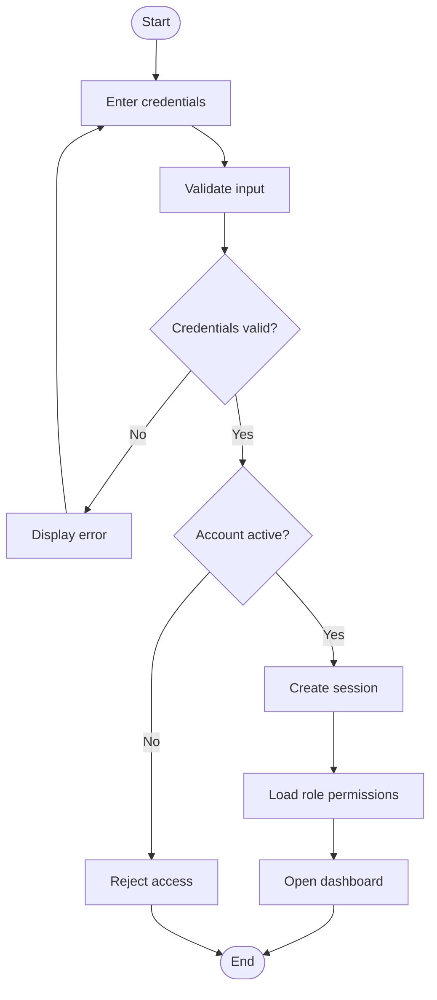
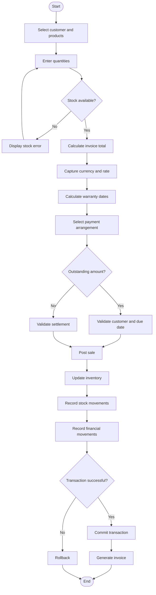
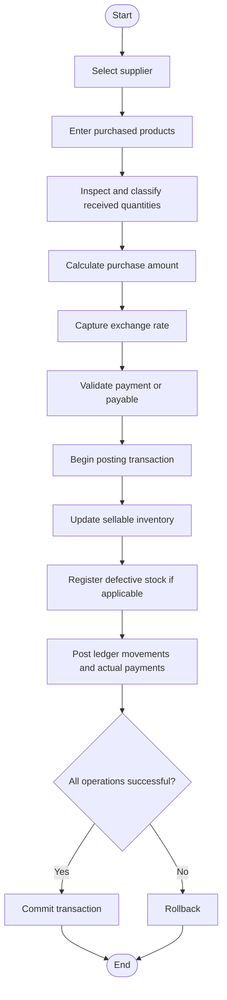
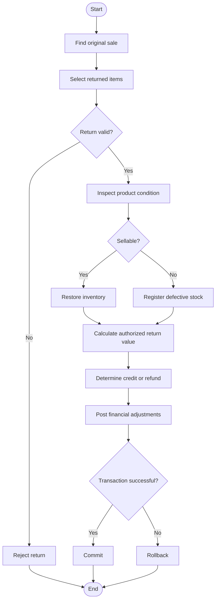
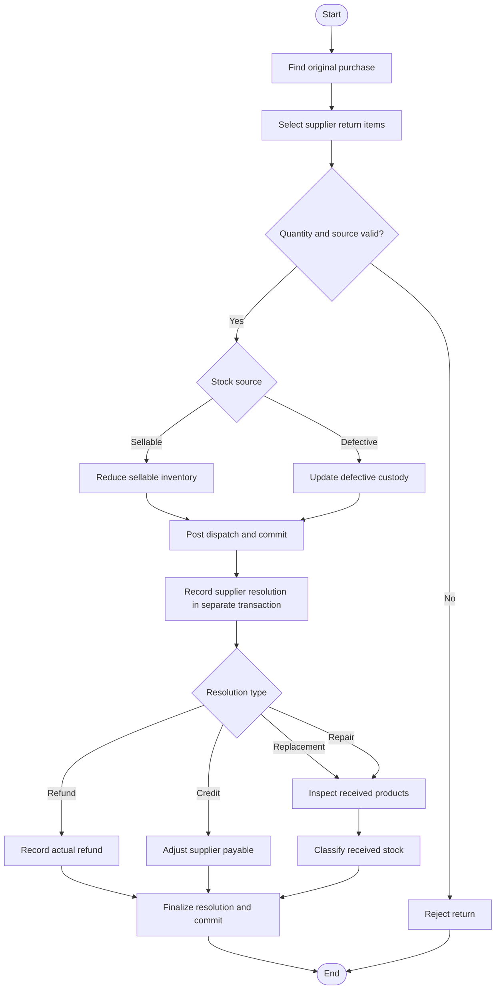
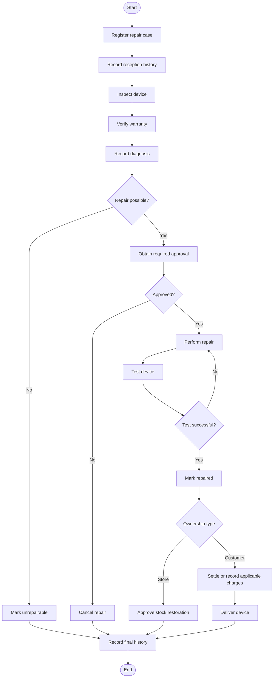
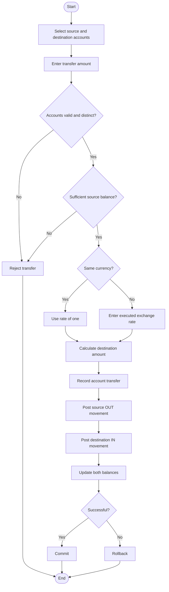

# FCSMS — Activity Diagrams

**Version:** 1.0  
**Project:** Forqani Computer Store Management System

These models describe business workflows. Each posting event must validate permissions and commit all relevant stock, financial and audit records atomically.

## 1. User authentication

## 2. Sales processing

## 3. Purchase processing

## 4. Customer return processing

## 5. Supplier return processing

## 6. Repair processing

## 7. Account transfer processing

**Repair history:** Each activity and status transition is recorded as it occurs; status and corresponding history updates are atomic.

**Supplier returns:** Dispatch and resolution are independent posting events. A failed event rolls back its own changes.
