# FCSMS — Class Diagram

**Version:** 1.0  
**Project:** Forqani Computer Store Management System

The class model describes logical service responsibilities, not verified existing Python classes.

## 1. Application service model

```mermaid
classDiagram
    direction TB
    class AuthService {
        +authenticate()
        +authorize()
        +logout()
    }
    class CatalogService {
        +createProduct()
        +updateProduct()
        +manageCategory()
    }
    class InventoryService {
        +checkStock()
        +increaseStock()
        +decreaseStock()
        +recordMovement()
    }
    class PurchaseService {
        +createPurchase()
        +postPurchase()
    }
    class SalesService {
        +createSale()
        +postSale()
        +generateInvoice()
    }
    class ReturnService {
        +validateReturn()
        +postReturn()
    }
    class SupplierReturnService {
        +dispatchReturn()
        +recordResolution()
    }
    class RepairService {
        +registerRepair()
        +assignTechnician()
        +updateStatus()
        +completeRepair()
    }
    class RepairHistoryService {
        +recordActivity()
        +getHistory()
    }
    class DefectiveStockService {
        +registerDefect()
        +splitStock()
        +restoreStock()
        +writeOff()
    }
    class PaymentService {
        +validatePayment()
        +recordPayment()
    }
    class FinancialAccountService {
        +createAccount()
        +getBalance()
    }
    class LedgerService {
        +postMovement()
        +reverseMovement()
        +reconcileBalance()
    }
    class LoanService {
        +createLoan()
        +recordRepayment()
        +calculateRemaining()
    }
    class TransferService {
        +transferFunds()
        +exchangeCurrency()
        +reverseTransfer()
    }
    class CurrencyService {
        +getRate()
        +updateRate()
        +recordRateHistory()
        +convertToAFN()
    }
    class WarrantyService {
        +calculateWarrantyDates()
        +verifyWarranty()
    }
    class ReportService {
        +generateReport()
        +exportReport()
    }
    class AuditService {
        +recordAction()
        +getAuditHistory()
    }
    PurchaseService --> InventoryService
    PurchaseService --> DefectiveStockService
    PurchaseService --> LedgerService
    PurchaseService --> CurrencyService
    SalesService --> InventoryService
    SalesService --> WarrantyService
    SalesService --> LedgerService
    SalesService --> CurrencyService
    ReturnService --> InventoryService
    ReturnService --> DefectiveStockService
    ReturnService --> LedgerService
    SupplierReturnService --> DefectiveStockService
    SupplierReturnService --> InventoryService
    SupplierReturnService --> LedgerService
    RepairService --> RepairHistoryService
    RepairService --> WarrantyService
    RepairService --> DefectiveStockService
    RepairService --> LedgerService
    PaymentService --> LedgerService
    LoanService --> LedgerService
    TransferService --> LedgerService
    TransferService --> CurrencyService
    LedgerService --> FinancialAccountService
```

