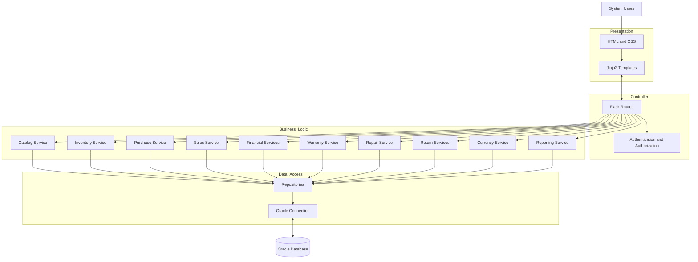

# FCSMS — Component Diagram

**Version:** 1.0  
**Project:** Forqani Computer Store Management System

The modular layered architecture separates presentation, controllers, domain services and Oracle data access. These are logical components rather than confirmed source-code modules.

## 1. Application components

