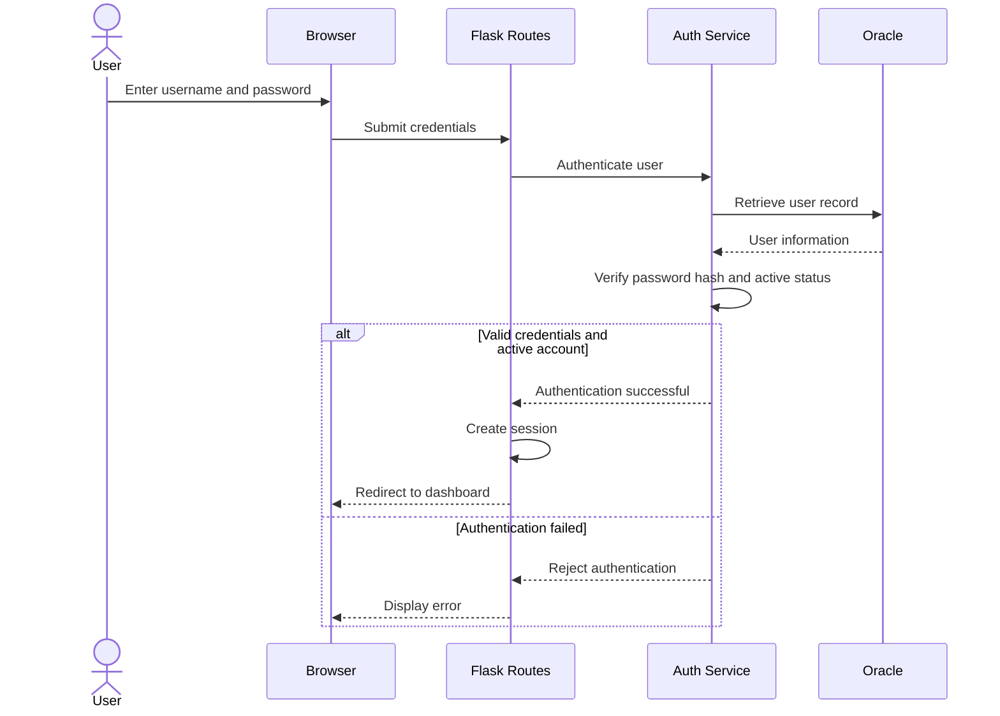
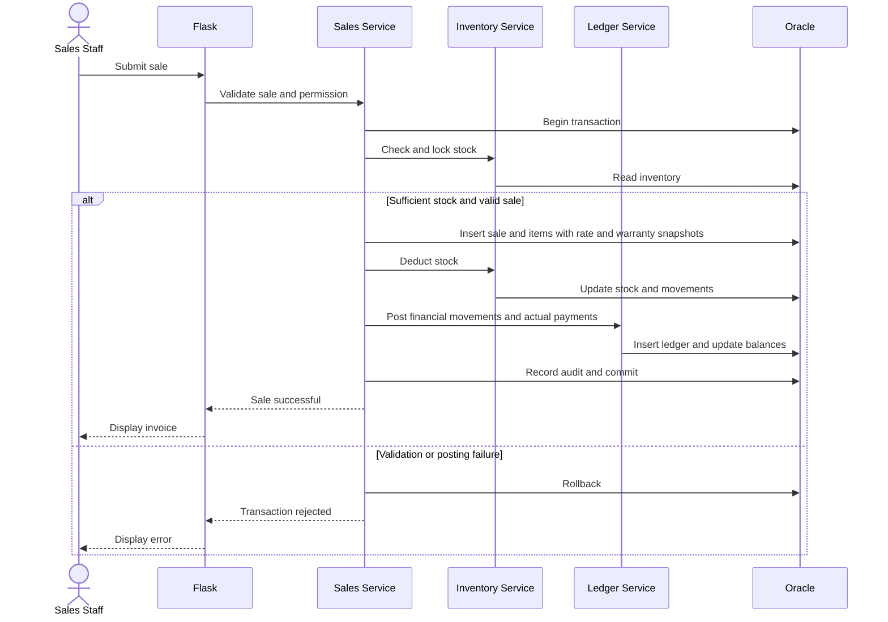
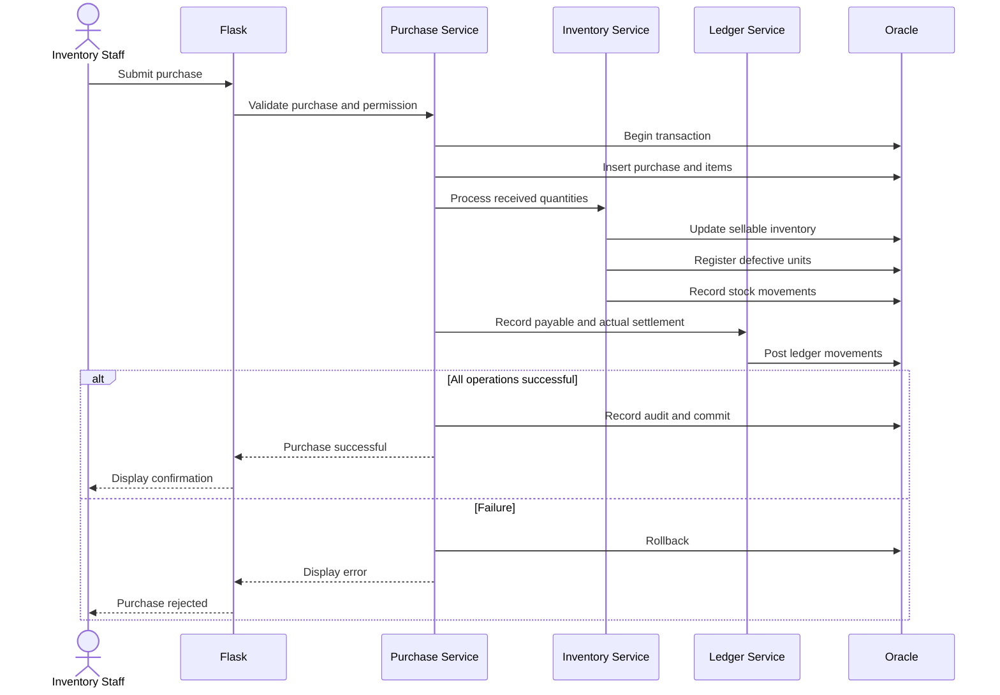
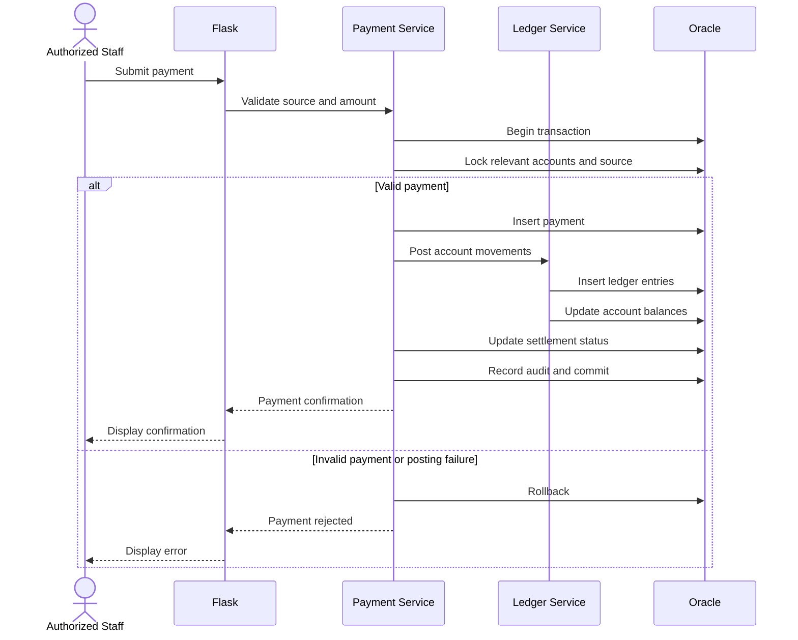
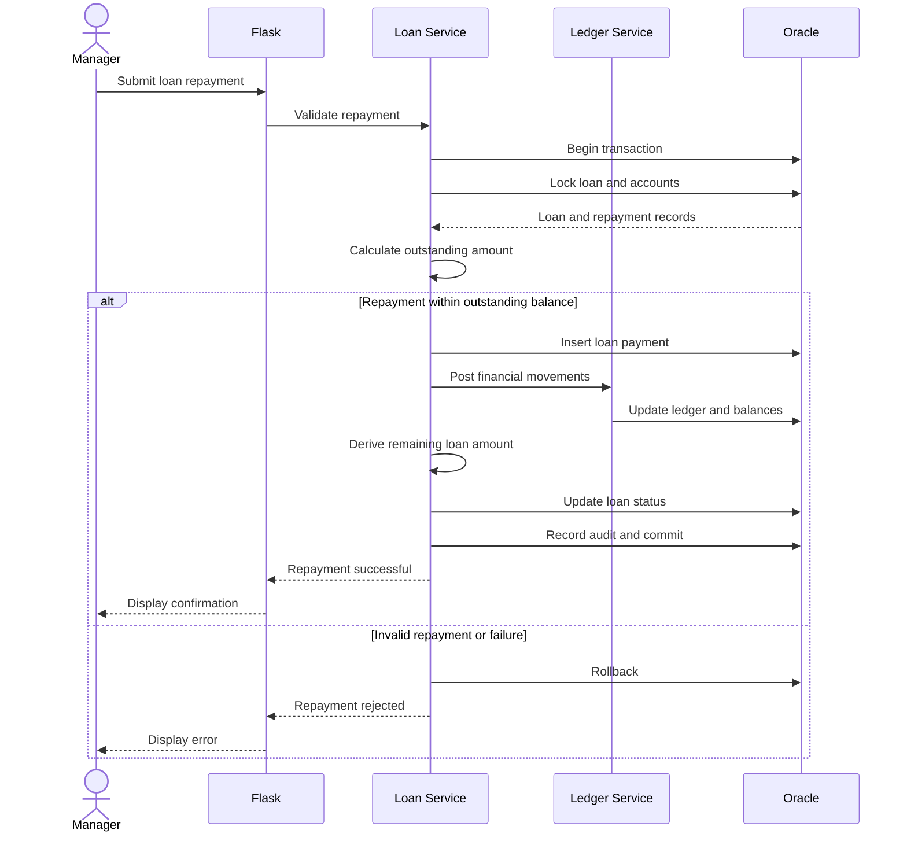
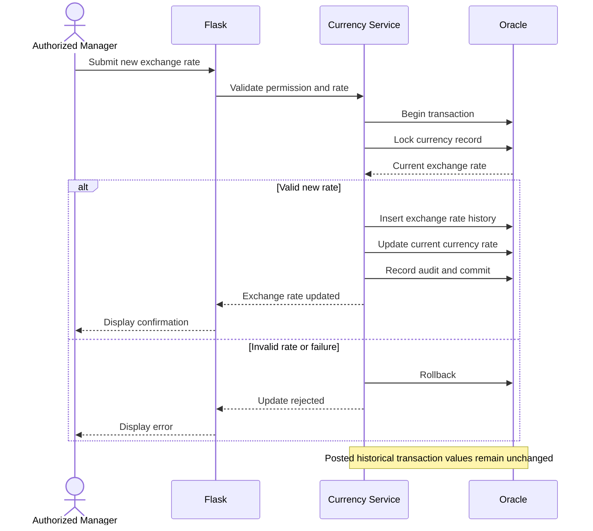
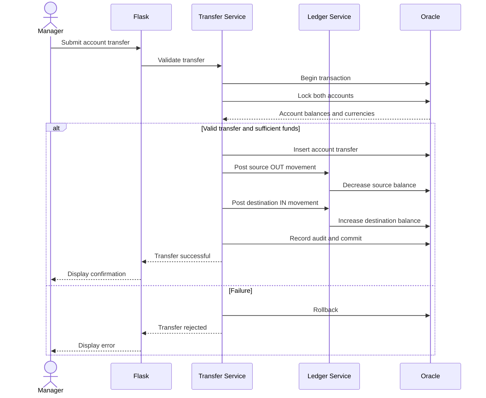
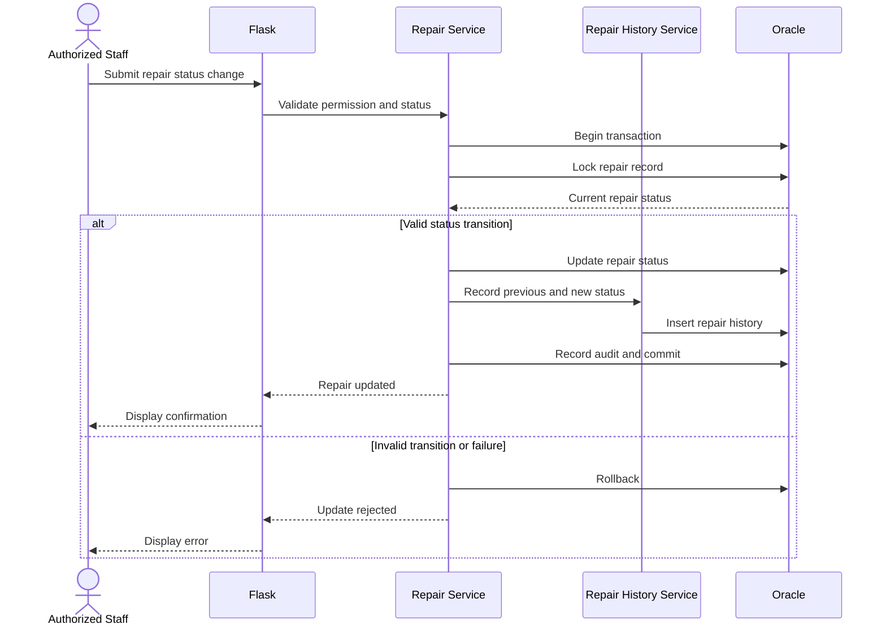
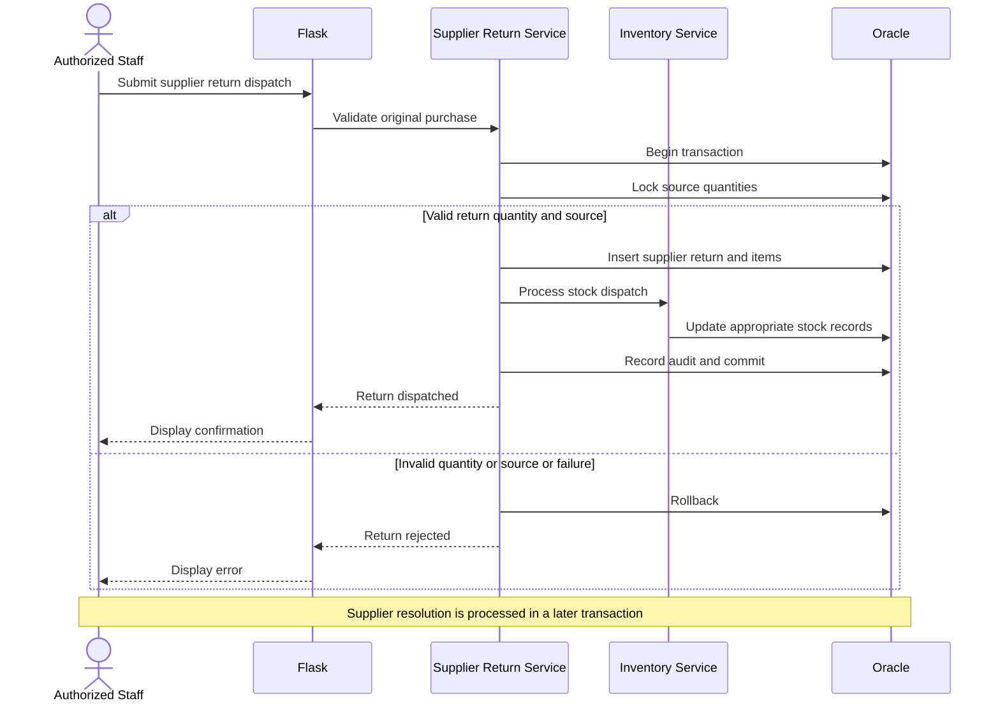
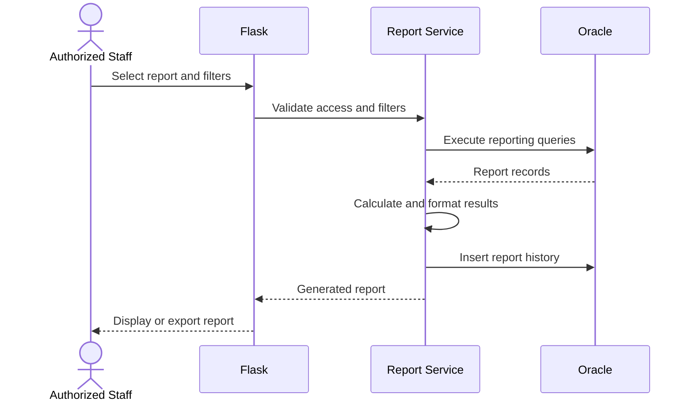

# FCSMS — Sequence Diagrams

**Version:** 1.0  
**Project:** Forqani Computer Store Management System

The sequences describe application interactions. Service names are logical design responsibilities. Financial and stock posting operations share one Oracle transaction; any failure rolls back all changes. Success responses follow commit.

## 1. Login

## 2. Sales

## 3. Purchase

## 4. Payment

## 5. Loan repayment

## 6. Exchange-rate update

## 7. Internal account transfer

## 8. Repair history

## 9. Supplier return dispatch

## 10. Report generation

