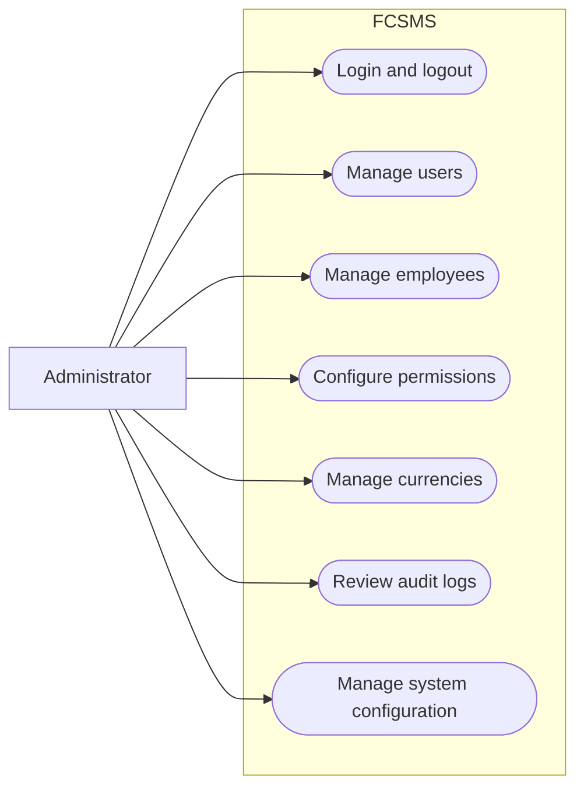
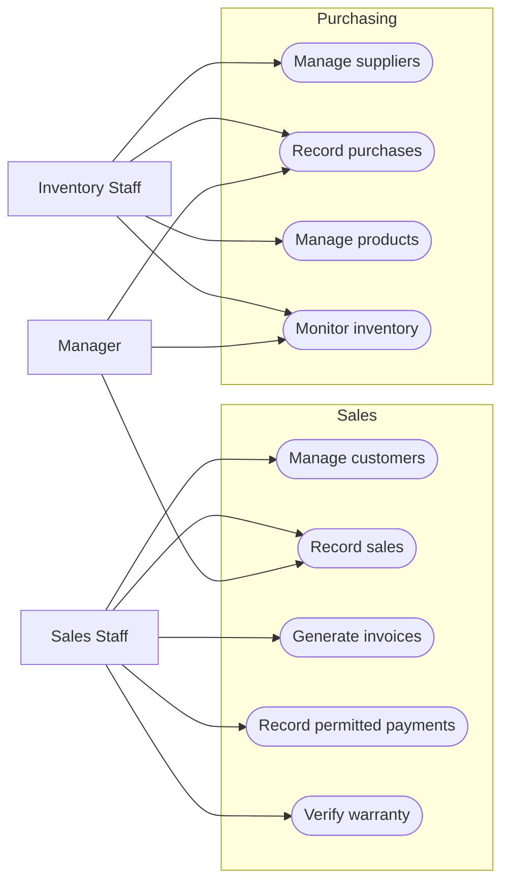
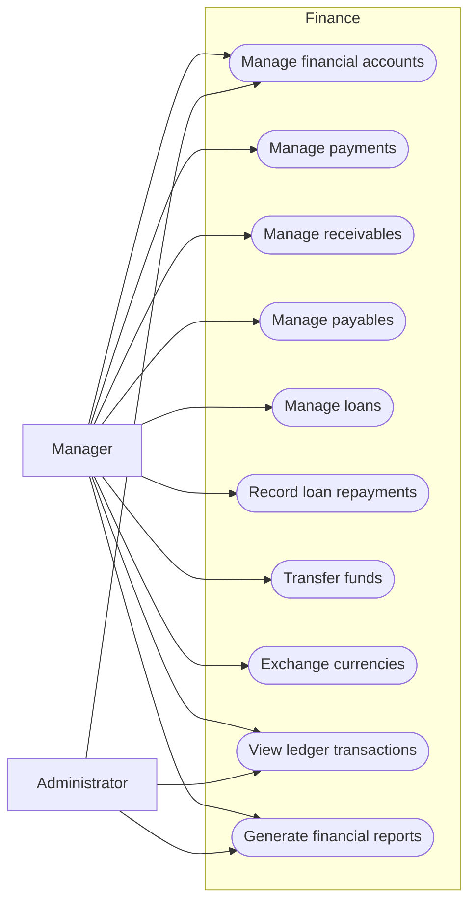
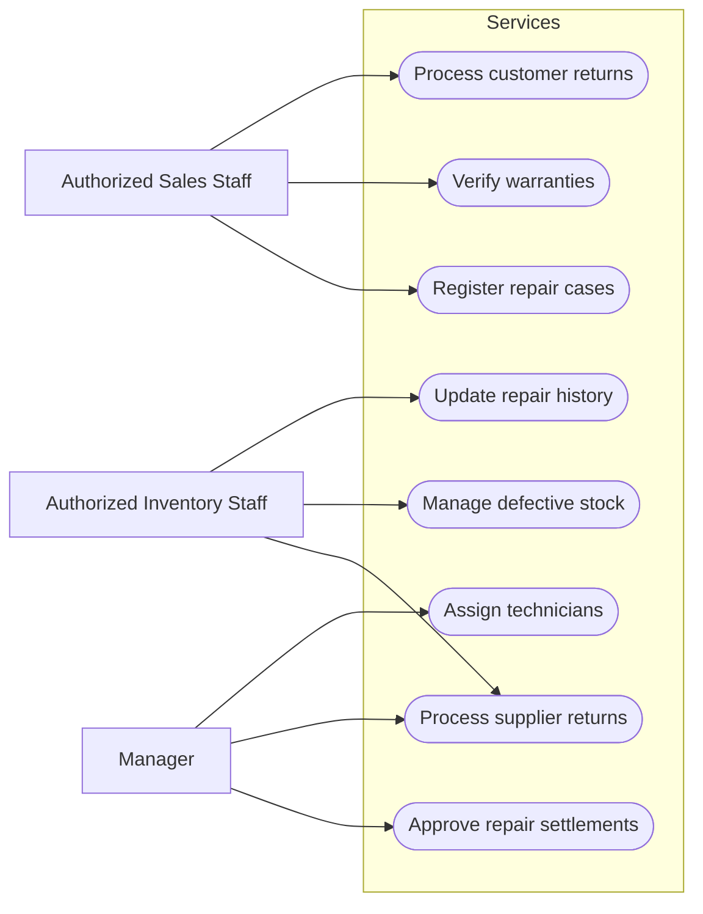

# FCSMS — Use Case Diagrams

**Version:** 1.0  
**Project:** Forqani Computer Store Management System

Mermaid flowcharts provide UML-inspired use case views. Actual operation permissions follow the SRS.

| Actor | Responsibilities |
|---|---|
| Administrator | Users, authorization, configuration and auditing |
| Manager | Business operations, financial management and approvals |
| Sales Staff | Customers, sales, invoices and permitted payments |
| Inventory Staff | Products, purchasing and stock management |

Technicians are employee records; no separate technician login role is introduced.

## 1. Administrative use cases

## 2. Sales and purchasing use cases

## 3. Financial management use cases

## 4. After-sales service use cases

